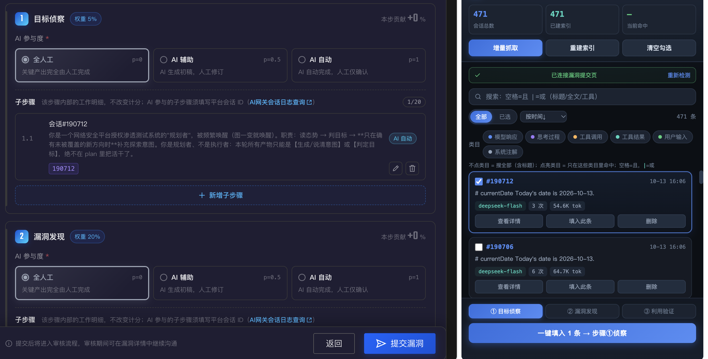

# ZC 会话追踪助手 — Chrome 侧边栏插件

腾讯安全众测平台（zc.tencent.com）辅助插件。在「提交漏洞」页面通过 Chrome Side Panel 侧边栏，**一键抓取全部 AI 网关会话日志 → 分类关键词检索锁定关联日志 → 勾选后一键填入「AI 参与程度申报」的子步骤**。



## 功能总览

### 1. 会话抓取（首次全量，之后增量）

- **首次「抓取全部」**：以 page_size=100 连翻所有列表页（约 350 条 = 4 页，~4 秒），随后自动为所有会话建立**分类详情索引**（8 并发 + 大会话多页并行，实测 347 条约 40 秒）。
- **之后「增量抓取」**：从第 1 页往后翻，碰到已知 session_id 即停——新会话永远在最新页，通常 1 个请求、1 秒内完成；只为新会话补建索引。
- **数据持久化**：按会话分键存入 `chrome.storage.local`（配额 `unlimitedStorage`），关闭侧边栏/重启浏览器不丢；索引逐条落盘，中途关闭不丢进度。
- **打开面板即显示缓存**，不自动打接口；需要更新时手动点「增量抓取」。
- 每条会话可单独「删除」（连同其索引一起清理）。

### 2. 分类检索（锁定关联日志的核心）

会话详情按条目分为六类，颜色区分：

| 类目     | 颜色 | 内容                                     |
| -------- | ---- | ---------------------------------------- |
| 模型响应 | 蓝   | AI 的正式回复文本                        |
| 思考过程 | 紫   | reasoning/思考内容                       |
| 工具调用 | 橙   | 工具名 + 命令/参数（如 Bash 的 command） |
| 工具结果 | 青   | 工具输出（含错误标记）                   |
| 用户输入 | 绿   | 发给模型的用户消息                       |
| 系统注解 | 灰   | system prompt / 会话注解                 |

- **搜索语法**：空格 = 且，`|` = 或，可混用。例：`注入 sql|ssrf` = (注入 AND sql) OR (注入 AND ssrf)。
- **搜索范围**：标题 + 会话 ID + 模型名 + 所选类目的全文内容。
- **类目过滤**：点亮类目 chip（可多选）= 关键词只在这些类目里命中；全不点 = 搜全部。例：只点「工具调用」搜 `curl`，只在工具命令里找。
- **命中呈现**：命中卡片显示「命中类目」标签（哪个类目里的）、关键词上下文摘要片段（高亮）。
- **筛选与排序**：全部 / 已选过滤；按时间、调用次数、tokens、会话 ID 排序。
- **顶部统计**：会话总数 / 已建索引 / 当前命中。

### 3. 会话详情查看器（预览完整会话）

- 每条会话「查看详情」打开全屏弹层，逐条展示全部事件（自动并行翻页拉全）。
- 每条目按类别左边框着色，头部显示序号 / 时间 / 字数，工具调用单独显示参数区，错误条目红色标记。
- 查看器内支持**条目内关键词过滤**（同样 AND/OR 语法）+ **类目 chips 过滤**（带各类目条数）+ 关键词高亮，快速确认"是不是要找的那条"。
- 未建索引的会话点开时自动现场拉取。
- Esc 或点遮罩关闭。

### 4. 一键填入子步骤

- 勾选若干会话（跨页保持，勾选顺序即填入顺序）→ 底部选目标步骤（① 目标侦察 / ② 漏洞发现 / ③ 利用验证）→「一键填入」。
- 对每条勾选会话自动完成：点「新增子步骤」→ 填名称 `会话#<id>` → 填描述（会话摘要）→ AI 参与度选「AI 自动」→ 填平台会话 ID → 点「确定」→ 以子步骤列表行数增加判定成败。
- 也支持单条「填入此条」。状态栏逐条回报成功/失败。

## 安装

**方式 A — 下载 Release 包（推荐）**：到 [Releases](https://github.com/Wh1teJ0ker/zc-trace-helper/releases) 下载最新 `zc-trace-helper-vX.Y.Z.zip`（校验和见包内同级 `checksums.txt`），解压得到扩展目录。

**方式 B — 源码加载**：clone 或下载本仓库源码。

加载步骤：

1. 打开 Chrome，访问 `chrome://extensions/`。
2. 右上角开启「开发者模式」。
3. 「加载已解压的扩展程序」→ 选择扩展目录（Release 包解压后即为扩展目录；源码方式选仓库根目录）。
4. 打开漏洞提交页 `https://zc.tencent.com/vuln/whiteHat/vulnSubmit?project_code=...`，点击工具栏插件图标，右侧弹出侧边栏。
5. 首次使用：点「抓取全部」→ 等待索引完成 → 搜索/查看 → 勾选 → 一键填入。

> 版本升级后若提示索引结构变更，点一次「重建索引」即可（会话列表无需重抓）。

## 发布流程（维护者）

1. 更新 `manifest.json` 的 `version` 字段。
2. 运行 `./release.sh <版本号>`（与 manifest 一致性自动校验）——提交改动、打 `vX.Y.Z` tag 并推送。
3. GitHub Actions 自动：校验 tag 与 manifest 一致 → 打包扩展 zip（排除开发文件）→ 生成 SHA256 校验和 → 创建 GitHub Release 并附上产物。

CI 配置见 `.github/workflows/release.yml`。

## 使用技巧

- **按内容找日志**：先「抓取全部」建好索引 → 直接搜漏洞相关的域名、路径、参数名 → 命中卡片看摘要确认 → 「查看详情」核对 → 勾选。
- **只在工具命令里找**：点亮「工具调用」chip，搜 `nmap|sqlmap|dirsearch` 等工具特征。
- **排除噪音**：系统注解里大量重复的 system prompt 会稀释结果，把「系统注解」chip 熄灭即可只搜业务内容。
- **定位大会话**：按 tokens 排序，靠前的会话信息量最大。

## 文件结构

```
zc-trace-helper/
├── manifest.json     # MV3 配置（sidePanel + content script + unlimitedStorage）
├── background.js     # service worker：点击图标打开侧边栏
├── sidepanel.html    # 侧边栏 UI（含详情查看器弹层）
├── sidepanel.js      # 搜索/筛选/排序、分类索引、查看器、填入调度、分键存储
├── content.js        # 页面内代理：API 请求（详情分类解析）+ 子步骤表单自动化
├── release.sh        # 本地发布脚本（提交 + tag + push，CI 接管打包）
├── .github/workflows/release.yml  # tag 触发的自动 Release CI
├── docs/             # 截图
└── README.md
```

## 已知边界

- 平台接口 page_size 上限 100（超限报错），会话列表按此分页。
- 会话详情分页并行拉取，超大会话（数百事件）约 1-2 秒；「进行中」的会话详情为抓取时刻快照，重新查看或重建索引可刷新。
- AI 参与度固定填「AI 自动」；如需「AI 辅助」，改 `content.js` 中 `fillSubstep` 标注处。
- 平台 UI 改版（类名变化）可能导致表单自动化失效，需同步更新 `content.js` 中的选择器。
